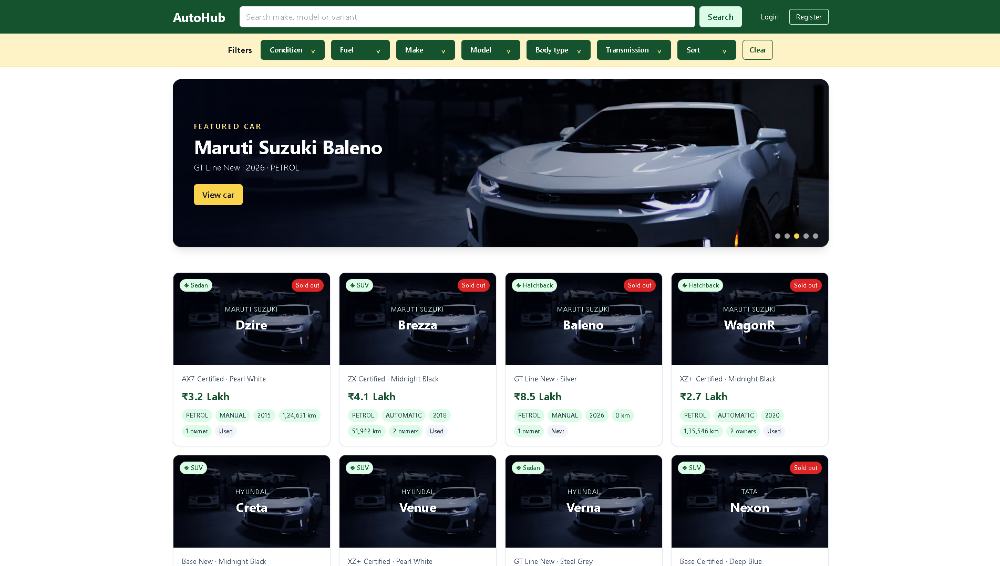
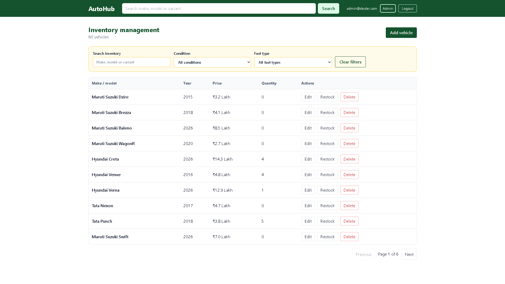
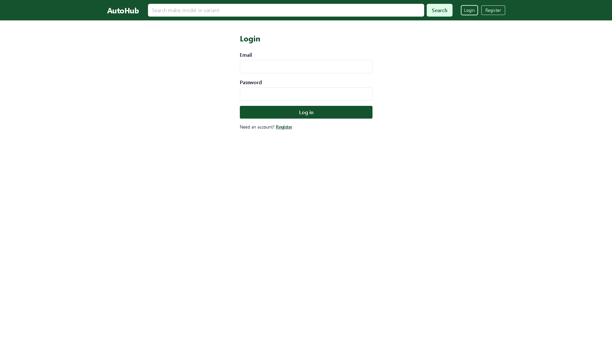
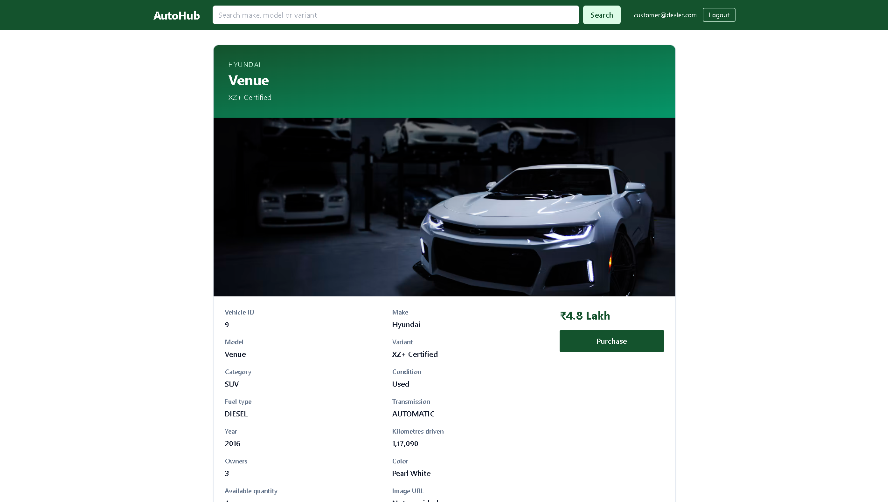

# AutoHub: Car Dealership Inventory System

Author: Eshaan Gupta

## Overview

This hiring take-home is a full-stack car-dealership inventory application. It provides a public vehicle catalogue, customer accounts and purchases, and administration of vehicles and stock.

The backend uses NestJS 11, TypeScript, Prisma 6.1.0, and PostgreSQL 16. The frontend uses React, Vite 6, Tailwind, react-router, and TanStack Query. Testing uses Jest with Supertest and Vitest with React Testing Library; GitHub Actions runs CI.

Live demo: `TODO: add live demo URL`.

The Render free tier sleeps when idle, so its first request can take 30 to 60 seconds.

## Screenshots

### Public vehicle catalogue



### Admin inventory management


### Login



### Vehicle detail and purchase



## Features and RBAC

- **Viewer**: anonymous visitor; this is not a database role. Viewers can browse the public catalogue.
- **Customer**: the default role assigned by registration. Customers can authenticate and purchase a vehicle.
- **Admin**: created only by the seed script. Admins manage vehicles and restock inventory.

Registration never creates administrators. Supplying a `role` field in a registration body returns `400` (covered by tests). Login deliberately returns the same `Invalid credentials` response for an unknown email and a wrong password.

## Product decisions

The brief marks `GET /vehicles` as protected. I deviated from that requirement because anonymous visitors must be able to browse before registering: all read endpoints are public, while write endpoints remain protected.

Purchasing is implemented as one atomic conditional `updateMany`: it requires `quantity > 0` and decrements stock in the same operation. A missing vehicle returns `404`; an out-of-stock vehicle returns `409`. The concurrency test submits 10 purchases in parallel against stock of 3 and expects 3 `200` responses, 7 `409` responses, and final stock of 0.

## Data and images

The seed data is fully synthetic. It is generated from a hand-written list of 35 Indian-market models and creates 60 vehicles, with the first 5 at quantity 0. A scraped CarDekho CSV and the DVM-Car dataset were considered but rejected because of licence/scraping concerns and market mismatch.

## API reference

All routes are under `/api`.

| Method | Route | Auth | Purpose / parameters |
| --- | --- | --- | --- |
| `GET` | `/health` | Public | Health check. |
| `POST` | `/auth/register` | Public | Register a customer. A `role` field is rejected. |
| `POST` | `/auth/login` | Public | Log in and receive credentials. |
| `GET` | `/auth/me` | Authenticated | Return the current user after a database check. |
| `GET` | `/vehicles` | Public | List vehicles; accepts the query parameters below. |
| `GET` | `/vehicles/search` | Public | Search/list vehicles; accepts the query parameters below. |
| `GET` | `/vehicles/filters` | Public | Return available filter values. |
| `GET` | `/vehicles/:id` | Public | Get one vehicle. |
| `POST` | `/vehicles` | Admin | Create a vehicle. |
| `PUT` | `/vehicles/:id` | Admin | Update a vehicle. |
| `DELETE` | `/vehicles/:id` | Admin | Delete a vehicle. |
| `POST` | `/vehicles/:id/purchase` | Authenticated | Atomically purchase one unit. |
| `POST` | `/vehicles/:id/restock` | Admin | Add stock with an `amount` body field. |

The list and search endpoints accept `q`, `make`, `model`, `category`, `fuelType`, `transmission`, `condition`, `minPrice`, `maxPrice`, `minYear`, `maxYear`, `maxKm`, `sort`, `page`, and `limit`. `limit` has a maximum of 50. `minPrice > maxPrice` returns `400`.

## Local setup

Start PostgreSQL from the repository root. The development database is exposed on `5432`; the test database is exposed on `5433`.

```powershell
docker compose up -d
```

### Backend

```powershell
Set-Location backend
Copy-Item .env.example .env
npm.cmd ci
npx prisma migrate deploy
npm.cmd run db:seed
npm.cmd run start:dev
```

The backend `.env.example` defines `DATABASE_URL`, `TEST_DATABASE_URL`, `JWT_SECRET`, `JWT_EXPIRES_IN`, and `CORS_ORIGIN`.

### Frontend

In a second terminal:

```powershell
Set-Location frontend
Copy-Item .env.example .env
npm.cmd ci
npm.cmd run dev
```

Set `VITE_API_URL=http://localhost:3000/api` in `frontend/.env` (this is the provided example value).

PowerShell can block `npm.ps1` under its execution policy; use `npm.cmd` as shown above when that occurs.

## Demo credentials

These credentials are for the seeded demo data only.

- Admin: `admin@dealer.com` / `Admin@12345`
- Customer: `customer@dealer.com` / `Customer@12345`

## Test report

The following commands were run on this checkout. The test database was reachable on port 5433; Docker itself was not available in the shell used to inspect it.

| Suite | Command | Result |
| --- | --- | --- |
| Backend unit/coverage | `npm.cmd run test:cov` | 2 suites passed; 2 tests passed. |
| Backend e2e | `npm.cmd run test:e2e` | 4 suites passed; 60 tests passed. |
| Frontend | `npm.cmd test` | 10 files passed; 16 tests passed. |

## Development process and honest history

The backend auth, vehicles, and inventory e2e tests were committed before their implementations: red first, then green. The frontend was not red-first: Codex wrote tests and code in the same session, so the test commits merely come first in commit order.

CI runs #4 to #7 were red because an AI-added dependency, `class-validator` 0.15.1, was outside `@nestjs/mapped-types`' peer range, causing `npm ci` to fail. Pinning it to 0.14.4 fixed the issue; run #8 was green.

Some intermediate frontend commits do not build independently because `lib/` was committed later. The branch tip builds from a clean clone, which was verified. Commit trailers originally used the brief's example email, which belongs to a real GitHub user. The history was rewritten and force-pushed so trailers now use `noreply@anthropic.com`, `codex@noreply.invalid`, and `copilot@noreply.invalid`.

## My AI usage

I used Claude (free), ChatGPT Codex, and GitHub Copilot.

Claude drafted the e2e test files and `InventoryService` (including atomic purchase and restock). I reviewed those changes, committed the tests before the implementation, and verified the result against the concurrency test. I did not write `InventoryService` alone.

Codex generated the scaffold, auth and vehicles modules, seed, CORS, the whole frontend, and the dependency pin. Copilot helped resolve an inventory wiring issue.

I caught these AI mistakes:

- The scaffold omitted `class-validator` and `class-transformer`.
- A Supertest default import failed because `esModuleInterop` was off.
- `InventoryService` was missing from providers, and a DTO needed `amount!:`.
- `class-validator` 0.15.1 broke `npm ci`.
- Adding the seed outside `src/` left a stale `dist`; Nest emitted `dist/src/main.js`, which was fixed by excluding `prisma` in `tsconfig.build.json`.
- A missing `frontend/.env` caused an empty listing; Codex diagnosed it.
- I found an open-redirect gap in my own suggested redirect rule, a `/login` session-expiry edge case, and uncommitted `lib/` files through a clean-clone build.

I verified the work through tests, a clean-clone build, CI, and a manual browser check. Full chat logs are in `PROMPTS.md`.

## Known trade-offs

- `JwtStrategy.validate` trusts the role in the token until it expires; `/auth/me` re-checks the database.
- `npm audit` reports 12 to 23 findings, mostly in development tooling.
- At startup, `/auth/me` with an expired token causes a session-expired redirect even on public pages.
- Demo images are illustrative and may not match the vehicle's model, year, or colour.
- Free-tier cold starts apply.

## TODOs

- TODO: add live demo URL.
- TODO: list source, author and licence of every image used.

## Real test output

`backend` — `npm.cmd run test:cov`:

```text
Test Suites: 2 passed, 2 total
Tests:       2 passed, 2 total
Snapshots:   0 total
Time:        6.716 s
Ran all test suites.
```

`backend` — `npm.cmd run test:e2e`:

```text
PASS test/vehicles.e2e-spec.ts (18.278 s)
PASS test/inventory.e2e-spec.ts (5.578 s)
PASS test/auth.e2e-spec.ts
PASS test/health.e2e-spec.ts

Test Suites: 4 passed, 4 total
Tests:       60 passed, 60 total
Snapshots:   0 total
Time:        26.355 s, estimated 27 s
Ran all test suites.
```

`frontend` — `npm.cmd test`:

```text
Test Files  10 passed (10)
Tests       16 passed (16)
Start at    20:53:54
Duration    3.67s (transform 740ms, setup 3.70s, collect 4.75s, tests 2.42s, environment 12.63s, prepare 4.84s)
```
